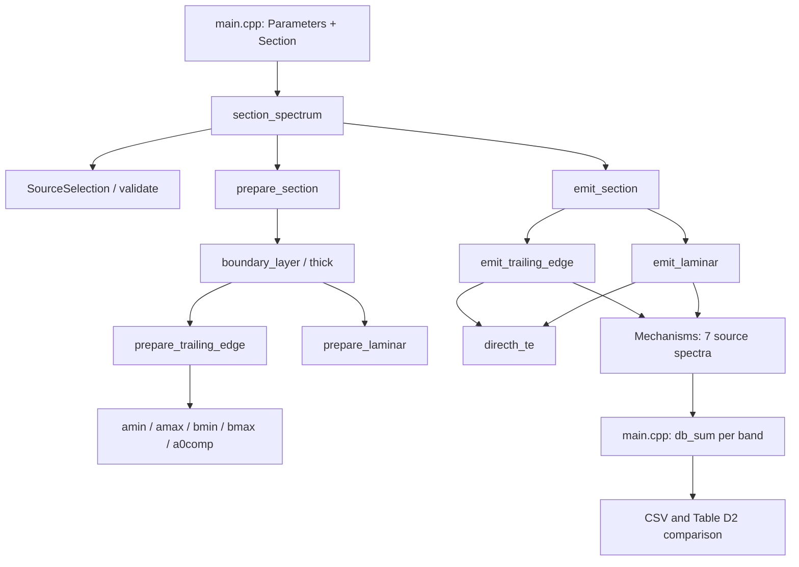
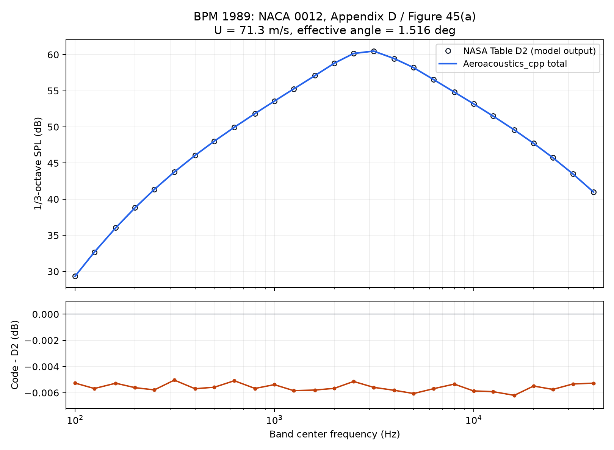

# 从一个翼段开始：复现 BPM 1989 自噪声算例

如果想先弄清楚这套代码怎样算出噪声，可以从这里开始。我们只放置一个固定翼段，给定来流和观察点，计算一条频谱。这个过程不需要准备风机模型，也不需要先跑 CFD；编译后，整个声学计算由 C++ 完成。

算例来自 Brooks、Pope 和 Marcolini 的经典报告：

> Brooks, T. F., Pope, D. S., and Marcolini, M. A. (1989). *Airfoil Self-Noise and Prediction*. NASA Reference Publication 1218.

[NASA 文献记录](https://ntrs.nasa.gov/citations/19890016302) · [报告全文](https://ntrs.nasa.gov/api/citations/19890016302/downloads/19890016302.pdf)

报告通常按三位作者的姓氏简称为 BPM。这里选用 Figure 45(a) 对应的 Appendix D 示例，因为报告同时给出了输入和逐频带输出，复现时不用先从曲线上估读数据。

| 要查什么 | 报告印刷页码 | PDF 阅读器页码（从 1 开始） |
| --- | ---: | ---: |
| Appendix D 示例输入 | 113 | 121 |
| Table D2：本算例的计算输出（27 个总声级已逐行对照原表图像） | 114 | 122 |
| 原程序的声速、运动黏度默认值 | 116 | 124 |

先记住这个区别：**表 D2 是原程序的预测结果，Figure 45(a) 还包含实验对照。** 本教程先验证代码能否复现原模型输出；它不据此声称已经通过实验验证。

## 先把程序跑起来

在仓库根目录执行。需要 CMake 3.20 或更高版本，以及支持 C++17 的编译器。这个目标不依赖 Fortran、MKL 或 Python。

Linux / macOS，使用单配置生成器：

```sh
cmake -S . -B build-bpm -DCMAKE_BUILD_TYPE=Release -DAEROACOUSTICS_BUILD_EXAMPLES=ON -DAEROACOUSTICS_BUILD_TURBINE=OFF
cmake --build build-bpm --target aeroacoustics_bpm1989 -j 4
./build-bpm/aeroacoustics_bpm1989 build-bpm/comparison.csv --check
```

Windows / MinGW，在 PowerShell 中执行：

```powershell
# 如果 g++、mingw32-make 已在 PATH 中，可以省略这一行。
# 否则请把路径换成自己电脑上的 mingw64/bin。
. ./tools/use_gcc.ps1 -GccBin 'D:/Code_Configuration/gcc-16.2.0/mingw64/bin'
cmake -S . -B build-bpm -G 'MinGW Makefiles' -DCMAKE_BUILD_TYPE=Release -DAEROACOUSTICS_BUILD_EXAMPLES=ON -DAEROACOUSTICS_BUILD_TURBINE=OFF
cmake --build build-bpm --target aeroacoustics_bpm1989 -j 4
./build-bpm/aeroacoustics_bpm1989.exe build-bpm/comparison.csv --check
```

使用 Visual Studio 生成器时，构建命令加 `--config Release`，运行路径改为 `build-bpm/Release/aeroacoustics_bpm1989.exe`。不要在同一个构建目录内切换生成器。

`--check` 要求与表 D2 的最大差值不超过 0.01 dB，超出时返回状态码 2。这是为这个固定算例设置的回归阈值，不是对模型实验精度的承诺。普通运行可去掉 `--check`；输出路径的父目录须已存在。不传参数时，会在当前目录写入 `bpm1989_comparison.csv`。

仓库附带的结果见 [results/comparison.csv](results/comparison.csv)。2026-10-08 使用 GCC 16.2.0、Release 配置运行得到：

```text
Max absolute difference: 0.00620027 dB
RMSE: 0.00559309 dB
```

## 我们到底在计算什么

空气流过翼型时，壁面附近会形成边界层。边界层内的扰动经过尾缘，能够向外辐射声音。BPM 用实验归纳的边界层关系和谱形函数来估计这种声音，不会在这里求解瞬时涡结构或声波传播方程。

本例打开了两组模型。湍流边界层尾缘噪声（TBL-TE）给出压力面、吸力面和分离相关的三个分量；层流边界层涡脱落噪声（LBL-VS）给出另一个分量。分离相关分量是 BPM 分解中的一项，它在小迎角下有数值，并不等于代码判定整个翼型已经失速。

“不强制转捩”也不等于“所有边界层始终层流”。这里的 `itrip=0` 是原文工况和经验关系的选择，并允许计算层流涡脱落分量。我们沿用原示例同时开启 `ITURB` 和 `ILAM` 的设置。

观察点处的结果是 **1/3 倍频程频带声压级**，参考声压为 20 μPa，没有施加 A 计权。中心频率沿用原表的 27 个名义频率，从 100 Hz 到 40000 Hz。不要把这些值当成 dB/Hz 的功率谱密度，也不要插入大量密集频点后直接累加为总声级。

## 把文献参数对应到代码

输入集中在 [main.cpp](main.cpp) 的 `Parameters p` 和 `Section s` 中。前者规定声学模型和空气参数，后者描述这个翼段与观察点。

| 物理量 | 文献设置 | 代码字段 |
| --- | ---: | --- |
| 翼型 | NACA 0012 | 使用 BPM 经验边界层关系，无坐标文件输入 |
| 弦长 c | 0.3048 m | `s.chord` |
| 展长 L | 0.4572 m | `s.span` |
| 来流速度 U | 71.3 m/s | `s.speed` |
| 有效迎角 α* | 1.516° | `s.alpha_deg` |
| 到观察点的距离 r | 1.22 m | `s.trailing.distance` |
| 指向角 θ、φ | 均为 90° | `s.trailing.theta`、`s.trailing.phi` |
| 声速 c₀ | 340.46 m/s | `p.spdsound` |
| 运动黏度 ν | 1.4529 × 10⁻⁵ m²/s | `p.kinvisc` |

这里最容易用错的是迎角。附录给的是有效迎角 `ALPSTAR=1.516`；不能直接拿图中风洞的几何迎角替换。声速和运动黏度也要显式赋值，因为它们与当前库的默认值略有不同。

对应的开关是：

```cpp
p.x_blmethod = 1;     // 根据弦长、Re、迎角和转捩条件估计边界层
p.itrip = 0;          // 不强制转捩
p.tbltemod = 1;       // BPM 湍流边界层尾缘模型
p.lammod = 1;         // 层流涡脱落模型
p.timod = 0;          // 不叠加入流湍流噪声
p.tipmod = 0;         // 不叠加翼尖涡噪声
p.bluntmod = 0;       // 不叠加钝尾缘噪声
p.aweighting = false;
```

`s.is_tip=false` 明确它不是翼尖段，`s.tabulated_boundary_layer=false` 表示不使用外部边界层表。`s.stall_deg=12.5` 沿用库的失速分支阈值；它不是从本算例测得的失速角，而且本例迎角远低于这个值。

由这些参数可以得到两个基本量：

$$
M=\frac{U}{c_0}\approx0.2094,\qquad Re_c=\frac{Uc}{\nu}\approx1.496\times10^6.
$$

前者进入声源尺度和指向性修正，后者用于边界层及谱形的经验关系。

## 声压级是怎样一步步算出来的

先估计边界层。`thick()` 根据弦长、雷诺数、迎角和转捩条件，计算压力面的边界层厚度 δp，以及压力面、吸力面的位移厚度 δ*p、δ*s。层流模型使用前者；本例的湍流尾缘模型使用后两者。边界层厚度与位移厚度不是同一个量，接外部数据时尤其不能互换。

接着把频率写成无量纲的 Strouhal 数。尾缘模型使用

$$
St_p=\frac{f\delta_p^*}{U},\qquad St_s=\frac{f\delta_s^*}{U},
$$

层流模型则使用压力面的边界层厚度 δp 构造频率尺度。这样的处理把不同速度、边界层厚度对应的谱形联系起来：特征长度或速度改变，谱峰的位置也会变化。

在当前未进入大分离分支的条件下，尾缘噪声的计算结构可概括为：

$$
\begin{aligned}
L_p &= 10\log_{10}\left(\frac{\delta_p^*M^5LD_h}{r^2}\right)+A_p+K_1-3+\Delta K_1,\\
L_s &= 10\log_{10}\left(\frac{\delta_s^*M^5LD_h}{r^2}\right)+A_s+K_1-3,\\
L_\alpha &= 10\log_{10}\left(\frac{\delta_s^*M^5LD_h}{r^2}\right)+B+K_2.
\end{aligned}
$$

这里的 A、B 描述谱形，K 系列是经验幅值修正；下标 p、s 分别表示压力面和吸力面。表达式沿用 BPM 的 SI 单位经验标定，不能只留下对数项就把它当作完整的声压级公式。原始分段系数较多，阅读时直接对照 [bpm_trailing_edge.cpp](../../src/acoustics/bpm_trailing_edge.cpp) 更容易确认每一项的来源。

层流涡脱落分量采用类似结构：

$$
L_{LBL}=10\log_{10}\left(\frac{\delta_p M^5LD_h}{r^2}\right)+G_1+G_2+G_3.
$$

G₁ 控制相对峰值频率的谱形，G₂ 随雷诺数比变化，G₃ 包含迎角相关的幅值项。这些关系在 [bpm_other_sources.cpp](../../src/acoustics/bpm_other_sources.cpp) 的 `prepare_laminar()` 中实现。

上述 Dₕ 是朝向观察点的辐射修正。当前调用的是 `directh_te()`，其关系为

$$
D_h=\frac{2\sin^2(\theta/2)\sin^2\phi}{(1+M\cos\theta)[1+(M-M_c)\cos\theta]^2},\qquad M_c=0.8M.
$$

本例 θ=φ=90°，Dₕ 接近 1。代码为保持与参考实现一致，角度转换系数使用 `0.017453`；它不是精确的 π/180。距离衰减已经包含在声源公式的 r² 中，因此这里不用再额外叠加一次球面扩散。

最后，把各分量的声能相加：

$$
L_{total}(f)=10\log_{10}\left[\sum_j10^{L_j(f)/10}\right].
$$

对应函数是 `db_sum()`。它先减去最大声级再求和，以改善数值稳定性。不要把四个 dB 数值直接相加；也要区分“同一频带内合并声源”与“跨频带求总体声级”。本例 CSV 的 `total_dB` 指前者。

## 对着源码走一遍调用链

程序入口只需要调用一次：

```cpp
const auto spectra = section_spectrum(p, s);
```

实际经过的函数如下。`prepare` 阶段准备与观察点无关的边界层、谱形和幅值系数；`emit` 阶段加入观察点的距离与指向性。



| 文件 | 本例中的职责 |
| --- | --- |
| [main.cpp](main.cpp) | 设置工况，调用声学库，汇总频带声能，与表 D2 比较并写 CSV |
| [aeroacoustics.hpp](../../include/aeroacoustics.hpp) | 定义 `Parameters`、`Section`、`Geometry` 以及公开函数 |
| [spectrum.cpp](../../src/acoustics/spectrum.cpp) | 校验输入、选择模型，组织准备和输出阶段，提供 `db_sum()` |
| [boundary_layer.cpp](../../src/acoustics/boundary_layer.cpp) | `boundary_layer()`、`thick()`：经验边界层厚度 |
| [bpm_trailing_edge.cpp](../../src/acoustics/bpm_trailing_edge.cpp) | 准备并输出压力面、吸力面和分离相关的尾缘分量 |
| [bpm_spectral_shapes.cpp](../../src/acoustics/bpm_spectral_shapes.cpp) | 尾缘模型使用的分段谱形函数 |
| [bpm_other_sources.cpp](../../src/acoustics/bpm_other_sources.cpp) | 本例仅调用其中的层流涡脱落准备与输出函数 |
| [directivity.cpp](../../src/acoustics/directivity.cpp) | `directh_te()`：尾缘声源的观察方向修正 |
| [mechanisms.hpp](../../include/mechanisms.hpp) | 定义七类声源的枚举、输出次序和名称 |

`section_spectrum()` 内部声明了通用的 `TnoWorkspace`，但在 `tbltemod=1` 时不会执行 TNO 准备或积分。本例也没有调用整机 BEM、结构动力学、控制器、时间推进及室外传播模块。读取调用链时，不能因为某个类型或源文件参与了库的构建，就认为其中的所有物理模型都参与了本次计算。

## 看懂输出，而不只看误差数字

CSV 每行对应一个频带。`LBL_dB` 是层流分量；`TBL_pressure_dB`、`TBL_suction_dB`、`TBL_separation_dB` 是三个尾缘分量。后面的 `total_dB`、`reference_D2_dB`、`difference_dB` 分别给出当前计算、文献模型值和二者之差。

`bluntness_dB`、`tip_dB`、`inflow_dB` 都是 `-inf`，表示禁用声源的零声能。它不是程序溢出。原表这些列中的 `0.000` 是占位符，不能当成真实的 0 dB 参与叠加。另一种常见数值是尾缘模型保留的 `-100 dB` 下限；它是极小的有限声级，与禁用的 `-inf` 含义不同。

本次结果中的几个频带：

| 频率 / Hz | 当前计算 / dB | 表 D2 / dB | 差值 / dB |
| ---: | ---: | ---: | ---: |
| 1000 | 53.562617 | 53.568 | -0.005383 |
| 3150 | 60.490411 | 60.496 | -0.005589 |
| 4000 | 59.449186 | 59.455 | -0.005814 |
| 16000 | 49.584800 | 49.591 | -0.006200 |



两条总谱在上图中基本重合，所以下图单独画出差值。最大差值出现在 16000 Hz；在这 27 个频带中，两组总谱的峰值都落在 3150 Hz。当前数值整体比表中结果低约 0.0056 dB。这个细小偏差的来源尚未逐项定位，不能仅凭它很小就归因于打印舍入。

这里的 RMSE 是逐频带 dB 差值的均方根：

$$
\mathrm{RMSE}=\sqrt{\frac{1}{27}\sum_{i=1}^{27}(L_i-L_{D2,i})^2}.
$$

它描述两组谱值的数值差异，不是宽带声压误差，也不是测量不确定度。

## 重新生成图和核查报告

`analyze.py` 会检查频率列表、有效声源的有限性、禁用声源的零能量、声能叠加以及差值。只生成 JSON 报告时，Python 标准库就够了：

```sh
python examples/bpm1989/analyze.py build-bpm/comparison.csv --output-dir build-bpm/report
```

绘图还需要 Matplotlib，建议在自己的 Python 虚拟环境中安装：

```sh
python -m pip install matplotlib
python examples/bpm1989/analyze.py build-bpm/comparison.csv --output-dir build-bpm/report --plot
```

输出为 `summary.json`、`comparison.png` 和可用于排版的矢量图 `comparison.svg`。CSV 由 C++ 程序生成，Python 只检查和绘图，没有替代声学计算。仓库中的 `results/` 保存本次运行快照；自己运行时建议使用构建目录，以便区分当前输出和归档结果。

## 跑通后，可以怎样继续理解模型

先改一个参数，比同时改整套配置更容易看出规律。例如把 `s.trailing.distance` 从 1.22 改成 2.44，重新编译后，各有效分量和总谱应降低约 6.0206 dB，因为这个算例只有公式中的 1/r² 衰减。也可以单独将展长加倍；在保持同一均匀翼段近似及其余参数不变时，声级应增加约 3.0103 dB。

如果将 `p.lammod` 改为 0，可以观察层流分量被移除后，总谱在哪些频带发生变化。若改变速度，边界层和 Strouhal 数也会随之改变，不能只套用 M⁵ 去平移整条频谱。

这些都是新的工况，运行时应去掉 `--check`，也不要用本教程的 `analyze.py` 判定它们是否通过表 D2 校验；CSV 中保留的 D2 列仍属于原工况。正式做参数扫描时，应另建入口并为每个工况保存输入与相应参考数据。

完成这些小练习后，再考虑提取 Figure 45(a) 的实验数据。那一步需要记录数字化误差，并确认试验的转捩、有效迎角、观测方向和修正约定。本算例只覆盖一个 NACA 0012 工况，不能用它证明其他翼型、失速工况、整机噪声或室外传播模型的准确度。
